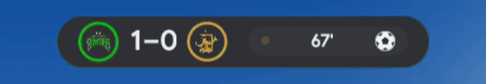

# 🏟️ Gameday

A small live score overlay for your team's game on your [Kiosk Satellite](https://github.com/jxlarrea/kiosk-satellite)
dashboard. It shows up before the game, follows the score, celebrates when your team scores, and fades away after the final.

## 📋 Contents

- [What you get](#-what-you-get) · [Sports](#-sports) · [Requirements](#-requirements) · [Install](#-install)
- [Settings](#-settings) · [Privacy](#-privacy) · [Troubleshooting](#-troubleshooting) · [Credits](#-credits)

## 🎯 What you get

- **Upcoming game:** the matchup and start time, with a countdown, starting a few hours ahead.
- **Live score:** the score and game clock, with team logos and colors.
- **Scoring celebration:** confetti when your team scores, and the scorer's side lights up.
- **Final score:** stays up for a while after the game, then fades out.

Gameday is an overlay that doesn't take touches, so taps go straight through to your dashboard. Notifications and
announcements still cover it while they're up.

## 🥎 Sports

| Sport | Supported | Tested |
| --- | :---: | :---: |
| Soccer | ✅ | ✅ |
| Baseball | ✅ | |
| Hockey | ✅ | |
| Football | ✅ | |
| Basketball | ✅ | |

"Tested" means checked with a real live game on a kiosk. If something looks off in a sport that isn't tested yet,
please open an issue.

## ✅ Requirements

- Kiosk Satellite 2026.10.13 or newer.
- Home Assistant with the [TeamTracker](https://github.com/vasqued2/ha-teamtracker) integration and a sensor for each
  team you want to display.

## 📲 Install

1. In Kiosk Satellite open **Plugin Manager**, turn on **Enable Plugins**, then choose **Add plugin**.
2. Enter this repository's address: `https://github.com/mpjanofsky/gameday-overlay`.
3. Check the preview, then **Trust and install**.
4. Turn the plugin on, open its settings and pick your **Team sensor**.
5. To see it right away, set **Preview** to **Live**, then back to **Off**.

Enable the plugin on each kiosk where you want it.

## ⚙️ Settings

| Setting | Default | What it does |
| --- | --- | --- |
| Team sensor | | Your team's TeamTracker sensor, for example `sensor.tampa_bay_rowdies` |
| Show upcoming game (hours before) | 3 | How long before the start the bar appears. 0 shows it only once the game starts |
| Keep final score (minutes) | 30 | How long the final score stays up. 0 hides it at the end of the game |
| Position | Top | Top, Bottom or a corner |
| Style | Crests | Crests show each team's logo in its colors. Text shows tinted abbreviations |
| Goal confetti | Shower | Shower, Drift or Sparkle |
| Size | Medium | Small, Medium or Large |
| Show over the screensaver | On | Also draw over the screensaver, menu and camera views |
| Preview | Off | Sample data to try the position and size. Turn off for normal use |

## 🔒 Privacy

Gameday reads your team sensor through Kiosk Satellite. To show logos and colors it downloads your league's team
list and the team logos from ESPN. Nothing about you or your kiosk is sent.

## 🛠️ Troubleshooting

| What you see | Check |
| --- | --- |
| Nothing shows | A team sensor is picked, the plugin is enabled on this kiosk, and the sensor isn't `NOT_FOUND` or `BYE` |
| Nothing between games | That's the design. Use **Preview** to see it any time |
| Wrong or missing logo | The bar falls back to text and retries after about 10 minutes |
| Hidden behind a popup | Notifications, announcements and Lockdown Mode always cover it |

## 🙏 Credits

- [Kiosk Satellite](https://github.com/jxlarrea/kiosk-satellite) and its
  [plugin template](https://github.com/jxlarrea/kiosk-satellite-plugin-hello-world), which the `sdk/` and `tools/`
  folders come from.
- [TeamTracker](https://github.com/vasqued2/ha-teamtracker) for the game data, and ESPN for team logos and colors.
- Not affiliated with or endorsed by Kiosk Satellite, TeamTracker or ESPN.

## 📚 More

- Ideas or problems? Open an issue.
- For developers: [building and changing it](docs/DEVELOPING.md).

🤖 Built with a lot of help from Claude, who worked with me on most of the design, code, tests and docs.

Code is Apache-2.0 (see [LICENSE](LICENSE) and [NOTICE](NOTICE)).
