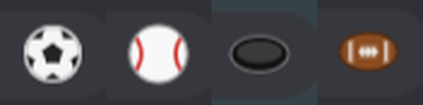

# Developing Gameday

## Build and test

Install Python 3, JDK 17 and an Android SDK with build-tools, then run:

```bash
scripts/check.sh
```

It runs the tests and writes `dist/gameday-<version>.zip`.

## Try a build on a kiosk

Use **Plugin Manager > Developer Tools > Install from ZIP**. A plugin installed from a local ZIP can't be replaced by the
GitHub version, and the other way around: uninstall first to switch sources. Uninstalling deletes the plugin's settings.

`tools/ks_install_plugin.py` installs a ZIP and changes settings through the Remote Admin API
(`install <zip>`, `state`, `set key=value ...`). It reads `KS_ADMIN_URL` and `KS_ADMIN_AUTH` from the environment or
from a gitignored `.local/LOCAL.md`.

## How it is organized

- `Match` reads the TeamTracker attributes, `BugState` decides what to show for a match and the clock, and `Display`
  is the result. These are plain Java with no Android imports, so the rules are tested off-device against
  `fixtures/teamtracker/`.
- `BugOverlay` is the only Android view code. `GamedayPlugin` wires it to Kiosk Satellite.
- `sdk/` and `tools/` come from the Kiosk Satellite plugin template and aren't edited here.

## Adding a sport

Logos, colors and game data work for any sport TeamTracker reports, because the league comes from the sensor. What
differs per sport is a handful of small rules, each a one- or two-line `switch` or `if`, keyed on TeamTracker's
lowercase `sport` value (`soccer`, `baseball`, `hockey`, `football`, `basketball`):

| Rule | Where | What it does |
| --- | --- | --- |
| Reading order | `BugState.awayFirst` | US sports read "away @ home", so the away team goes on the left. Soccer, and any sport not listed, reads home first |
| Game length | `BugState.spanMs` | How long after the start a game can run before a stale sensor is treated as over |
| Final label | `BugState.finalLabel` | `FT` for soccer, `Final` for everything else, unless TeamTracker's own text is short enough to use |
| Scoring word | `GamedayPlugin.goalWord` | `GOAL`, `RUN` or `SCORE` while your team's celebration shows |
| Icon | `Ball` | A few shapes drawn in code, so the plugin ships no image files. Unknown sports get the soccer ball |
| Preview tour | `GamedayPlugin.TOUR` | The sports shown by the **Sport tour** preview |



To add one: add the cases above, add a fixture under `fixtures/teamtracker/` and a test for its rules, then run
`scripts/check.sh` and try it with the **Sport tour** preview on a kiosk. Basketball is supported but still uses the
soccer ball and the plain `SCORE` word, so it is a good first one to finish.

Real live game snapshots make the best fixtures. Home Assistant's history keeps full attributes for about ten days, so
save them soon after the game.
